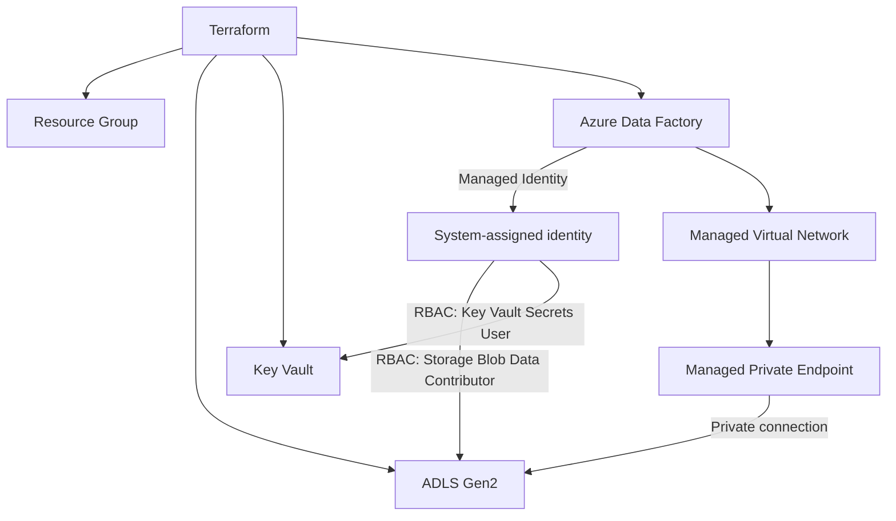

# Secure-ADF-Platform-with-Terraform
# Secure Azure Data Platform with Terraform

Infrastructure as Code project for a secure data ingestion foundation on Azure using **Terraform**. The intended platform includes **Azure Data Factory (ADF)** with a **Managed Virtual Network**, **ADLS Gen2**, and **Azure Key Vault**. The platform resource and module files are currently placeholders; only the Terraform state bootstrap is implemented.

---

## Architecture

```
                         Terraform
                             |
          +------------------+------------------+
          |                  |                  |
          v                  v                  v
   Resource Group        ADLS Gen2          Key Vault
          |                  ^                  ^
          |                  | RBAC             | RBAC
          |                  |                  |
          +-----------> Azure Data Factory -----+
                             |
                      Managed Identity
                             |
                       Managed VNet
                             |
                  Managed Private Endpoint
                             |
                             v
                         ADLS Gen2
```



---

## Planned Resources

| Resource | Purpose |
|---|---|
| **Resource Group** | Logical container for all resources |
| **ADLS Gen2 Storage Account** | Data lake storage with Hierarchical Namespace enabled |
| **Azure Key Vault** | Secret storage, RBAC authorization model |
| **Azure Data Factory** | Orchestration and data movement, with a system-assigned managed identity |
| **Managed Virtual Network + Integration Runtime** | Network isolation for ADF compute |
| **Managed Private Endpoint** | Private connection from ADF to ADLS Gen2 (`dfs` sub-resource) |
| **Role Assignments** | ADF identity gets least-privilege access to ADLS Gen2 and Key Vault |

---

## Key Design Decisions

- **Managed Identity instead of keys.** ADF authenticates to ADLS Gen2 and Key Vault with its own identity. No connection strings or storage keys are stored anywhere.
- **RBAC instead of access policies.** Key Vault uses the RBAC permission model for consistent, auditable access control.
- **Private connectivity.** Traffic between ADF and ADLS Gen2 goes through a Managed Private Endpoint inside ADF's Managed VNet and does not cross the public internet.
- **Least privilege.** The ADF identity gets only the roles it needs:
  - `Storage Blob Data Contributor` on the storage account
  - `Key Vault Secrets User` on the Key Vault
- **Everything as code.** The whole environment is reproducible and reviewable through Terraform.

---

## Prerequisites

- [Terraform](https://developer.hashicorp.com/terraform/install) >= 1.5
- [Azure CLI](https://learn.microsoft.com/cli/azure/install-azure-cli), logged in with `az login`
- An Azure subscription where the bootstrap identity can create resource groups and role assignments (for example, **Owner**, or **Contributor + User Access Administrator** at subscription scope)

---

## Project Structure

```
.
├── bootstrap/          # Independent Terraform state storage and role assignments
├── modules/
│   ├── storage/        # Placeholder storage module
│   └── data-factory/   # Placeholder Data Factory module
├── main.tf             # Placeholder platform configuration
├── variables.tf        # Placeholder input variables
├── outputs.tf          # Placeholder outputs
├── providers.tf        # Azure provider and remote backend configuration
├── terraform.tfvars    # Environment values (do not commit secrets)
└── README.md
```

---

## Getting Started

### 1. Clone the repository

```bash
git clone https://github.com/pkhamit10/Secure-ADF-Platform-with-Terraform.git
cd Secure-ADF-Platform-with-Terraform
```

### 2. Log in to Azure

```bash
az login
az account set --subscription "<subscription-id>"
export ARM_SUBSCRIPTION_ID="<subscription-id>"
```

### 3. Bootstrap Terraform state

The separate bootstrap configuration uses **local state** to create a resource group, a storage account, a private `tfstate` container, and two role assignments for the current Terraform identity: **Contributor** on the bootstrap resource group and **Storage Blob Data Contributor** on the container. Contributor on this resource group does not grant permissions to deploy the platform in another resource group or to create role assignments. The bootstrap identity must already have the prerequisite permissions above.

Replace the example names with your own globally unique storage account name:

```bash
terraform -chdir=bootstrap init
terraform -chdir=bootstrap validate
terraform -chdir=bootstrap plan \
  -var="resource_group_name=rg-adf-tfstate-dev" \
  -var="storage_account_name=<globally-unique-storage-account-name>"
terraform -chdir=bootstrap apply \
  -var="resource_group_name=rg-adf-tfstate-dev" \
  -var="storage_account_name=<globally-unique-storage-account-name>"
```

Use the **same identity** for subsequent bootstrap operations: changing it changes the role assignment principal. The state account disables shared-key and public blob access, requires HTTPS/TLS 1.2, and enables blob versioning and seven-day blob and container soft deletion. The storage endpoint remains publicly reachable; use network restrictions suitable for your runners if required.

The bootstrap state remains local in `bootstrap/terraform.tfstate`. Protect and back up that file securely, including after any later changes; it is not stored in the new backend automatically. Never commit state or secrets. Do not destroy the bootstrap resources while they contain state needed by the platform.

To run the offline, mocked bootstrap tests, use Terraform 1.7 or later and run `terraform -chdir=bootstrap test` after initialization.

### 4. Configure the platform backend

After applying bootstrap, use its outputs to initialize the root configuration. Allow time for Azure RBAC permissions to propagate if initialization is denied.

```bash
terraform init \
  -backend-config="resource_group_name=$(terraform -chdir=bootstrap output -raw resource_group_name)" \
  -backend-config="storage_account_name=$(terraform -chdir=bootstrap output -raw storage_account_name)" \
  -backend-config="container_name=$(terraform -chdir=bootstrap output -raw container_name)" \
  -backend-config="key=platform.tfstate" \
  -backend-config="use_azuread_auth=true"
```

The root configuration uses the same Azure CLI identity. Other users or CI identities need their own appropriate state-container data role and platform deployment permissions; this bootstrap grants only the current identity. Use separate backend keys for separate environments.

### 5. Implement and deploy the platform

The root resource files and modules are placeholders and currently deploy no platform resources. Add the platform configuration and its variables before running `terraform plan` and `terraform apply`. Do not put credentials in `terraform.tfvars`.

### 6. Approve the Managed Private Endpoint

A managed private endpoint is created in a **Pending** state. It must be approved on the target resource before ADF can use it:

- **Portal:** Storage account > Networking > Private endpoint connections > select the pending connection > **Approve**
- **CLI:**

```bash
az network private-endpoint-connection approve \
  --id <private-endpoint-connection-id> \
  --description "Approved for ADF"
```

### 7. Clean up

```bash
terraform destroy
```

This destroys resources managed by the root configuration, not the separate bootstrap. Only remove the bootstrap after all dependent state is no longer needed and is safely backed up.

---

## Example Snippets

### ADLS Gen2 storage account

```hcl
resource "azurerm_storage_account" "adls" {
  name                     = var.storage_account_name
  resource_group_name      = azurerm_resource_group.rg.name
  location                 = azurerm_resource_group.rg.location
  account_tier             = "Standard"
  account_replication_type = "LRS"
  account_kind             = "StorageV2"
  is_hns_enabled           = true   # enables ADLS Gen2
}
```

### Data Factory with Managed VNet and Managed Identity

```hcl
resource "azurerm_data_factory" "adf" {
  name                            = var.data_factory_name
  location                        = azurerm_resource_group.rg.location
  resource_group_name             = azurerm_resource_group.rg.name
  managed_virtual_network_enabled = true

  identity {
    type = "SystemAssigned"
  }
}
```

### RBAC for the ADF identity

```hcl
resource "azurerm_role_assignment" "adf_to_adls" {
  scope                = azurerm_storage_account.adls.id
  role_definition_name = "Storage Blob Data Contributor"
  principal_id         = azurerm_data_factory.adf.identity[0].principal_id
}

resource "azurerm_role_assignment" "adf_to_kv" {
  scope                = azurerm_key_vault.kv.id
  role_definition_name = "Key Vault Secrets User"
  principal_id         = azurerm_data_factory.adf.identity[0].principal_id
}
```

### Managed Private Endpoint to ADLS Gen2

```hcl
resource "azurerm_data_factory_managed_private_endpoint" "adls" {
  name               = "mpe-adls"
  data_factory_id    = azurerm_data_factory.adf.id
  target_resource_id = azurerm_storage_account.adls.id
  subresource_name   = "dfs"
}
```

---

## Security Notes

- No storage account keys, SAS tokens or passwords are used in ADF linked services.
- Store any remaining secrets (for example third-party API keys) in Key Vault and reference them from ADF.
- Consider disabling public network access on the storage account after the managed private endpoint is approved.
- Use a remote Terraform backend (Azure Storage with state locking) for team use, and never commit `terraform.tfstate` or secrets.

---

## Tech Stack

`Terraform` · `Azure Data Factory` · `ADLS Gen2` · `Azure Key Vault` · `Managed Identity` · `Azure RBAC` · `Managed VNet` · `Private Endpoints`

---

## Author

**Punitha Krishnasamy**
GitHub: [@pkhamit10](https://github.com/pkhamit10)

---

## License

This project is licensed under the [MIT License](LICENSE).