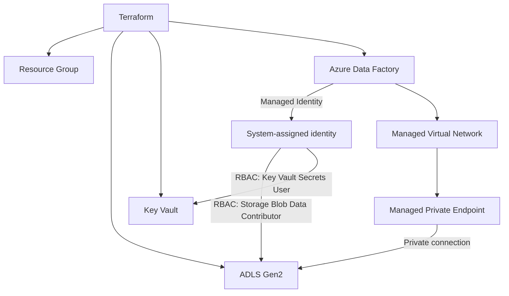

# Secure-ADF-Platform-with-Terraform
# Secure Azure Data Platform with Terraform

Infrastructure as Code project that deploys a secure data ingestion foundation on Azure using **Terraform**. It provisions **Azure Data Factory (ADF)** with a **Managed Virtual Network**, connects it to **ADLS Gen2** over a **Managed Private Endpoint**, and keeps secrets in **Azure Key Vault**. Access is controlled entirely through **Managed Identity and RBAC**, with no access keys or stored credentials.

---

## Architecture

```
                         Terraform
                             |
          +------------------+------------------+
          |                  |                  |
          v                  v                  v
   Resource Group        ADLS Gen2          Key Vault
          |                  ^                  ^
          |                  | RBAC             | RBAC
          |                  |                  |
          +-----------> Azure Data Factory -----+
                             |
                      Managed Identity
                             |
                       Managed VNet
                             |
                  Managed Private Endpoint
                             |
                             v
                         ADLS Gen2
```



---

## What Gets Deployed

| Resource | Purpose |
|---|---|
| **Resource Group** | Logical container for all resources |
| **ADLS Gen2 Storage Account** | Data lake storage with Hierarchical Namespace enabled |
| **Azure Key Vault** | Secret storage, RBAC authorization model |
| **Azure Data Factory** | Orchestration and data movement, with a system-assigned managed identity |
| **Managed Virtual Network + Integration Runtime** | Network isolation for ADF compute |
| **Managed Private Endpoint** | Private connection from ADF to ADLS Gen2 (`dfs` sub-resource) |
| **Role Assignments** | ADF identity gets least-privilege access to ADLS Gen2 and Key Vault |

---

## Key Design Decisions

- **Managed Identity instead of keys.** ADF authenticates to ADLS Gen2 and Key Vault with its own identity. No connection strings or storage keys are stored anywhere.
- **RBAC instead of access policies.** Key Vault uses the RBAC permission model for consistent, auditable access control.
- **Private connectivity.** Traffic between ADF and ADLS Gen2 goes through a Managed Private Endpoint inside ADF's Managed VNet and does not cross the public internet.
- **Least privilege.** The ADF identity gets only the roles it needs:
  - `Storage Blob Data Contributor` on the storage account
  - `Key Vault Secrets User` on the Key Vault
- **Everything as code.** The whole environment is reproducible and reviewable through Terraform.

---

## Prerequisites

- [Terraform](https://developer.hashicorp.com/terraform/install) >= 1.5
- [Azure CLI](https://learn.microsoft.com/cli/azure/install-azure-cli), logged in with `az login`
- An Azure subscription where you have **Owner** or **Contributor + User Access Administrator** (needed to create role assignments)

---

## Project Structure

```
.
├── main.tf             # Resource group, storage, Key Vault, ADF
├── network.tf          # Managed VNet integration runtime, managed private endpoint
├── rbac.tf             # Role assignments for the ADF managed identity
├── variables.tf        # Input variables
├── outputs.tf          # Useful outputs (names, IDs, endpoints)
├── providers.tf        # Provider and backend configuration
├── terraform.tfvars    # Your environment values (do not commit secrets)
└── README.md
```

> Adjust the file names to match your repository layout.

---

## Getting Started

### 1. Clone the repository

```bash
git clone https://github.com/pkhamit10/<your-repo-name>.git
cd <your-repo-name>
```

### 2. Log in to Azure

```bash
az login
az account set --subscription "<subscription-id>"
```

### 3. Configure variables

Create a `terraform.tfvars` file:

```hcl
location            = "westeurope"
resource_group_name = "rg-dataplatform-dev"
storage_account_name = "stdataplatformdev001"   # globally unique, 3-24 lowercase letters/numbers
key_vault_name      = "kv-dataplatform-dev-001" # globally unique
data_factory_name   = "adf-dataplatform-dev"
```

### 4. Deploy

```bash
terraform init
terraform fmt -check
terraform validate
terraform plan -out tfplan
terraform apply tfplan
```

### 5. Approve the Managed Private Endpoint

A managed private endpoint is created in a **Pending** state. It must be approved on the target resource before ADF can use it:

- **Portal:** Storage account > Networking > Private endpoint connections > select the pending connection > **Approve**
- **CLI:**

```bash
az network private-endpoint-connection approve \
  --id <private-endpoint-connection-id> \
  --description "Approved for ADF"
```

### 6. Clean up

```bash
terraform destroy
```

---

## Example Snippets

### ADLS Gen2 storage account

```hcl
resource "azurerm_storage_account" "adls" {
  name                     = var.storage_account_name
  resource_group_name      = azurerm_resource_group.rg.name
  location                 = azurerm_resource_group.rg.location
  account_tier             = "Standard"
  account_replication_type = "LRS"
  account_kind             = "StorageV2"
  is_hns_enabled           = true   # enables ADLS Gen2
}
```

### Data Factory with Managed VNet and Managed Identity

```hcl
resource "azurerm_data_factory" "adf" {
  name                            = var.data_factory_name
  location                        = azurerm_resource_group.rg.location
  resource_group_name             = azurerm_resource_group.rg.name
  managed_virtual_network_enabled = true

  identity {
    type = "SystemAssigned"
  }
}
```

### RBAC for the ADF identity

```hcl
resource "azurerm_role_assignment" "adf_to_adls" {
  scope                = azurerm_storage_account.adls.id
  role_definition_name = "Storage Blob Data Contributor"
  principal_id         = azurerm_data_factory.adf.identity[0].principal_id
}

resource "azurerm_role_assignment" "adf_to_kv" {
  scope                = azurerm_key_vault.kv.id
  role_definition_name = "Key Vault Secrets User"
  principal_id         = azurerm_data_factory.adf.identity[0].principal_id
}
```

### Managed Private Endpoint to ADLS Gen2

```hcl
resource "azurerm_data_factory_managed_private_endpoint" "adls" {
  name               = "mpe-adls"
  data_factory_id    = azurerm_data_factory.adf.id
  target_resource_id = azurerm_storage_account.adls.id
  subresource_name   = "dfs"
}
```

---

## Security Notes

- No storage account keys, SAS tokens or passwords are used in ADF linked services.
- Store any remaining secrets (for example third-party API keys) in Key Vault and reference them from ADF.
- Consider disabling public network access on the storage account after the managed private endpoint is approved.
- Use a remote Terraform backend (Azure Storage with state locking) for team use, and never commit `terraform.tfstate` or secrets.

---

## Tech Stack

`Terraform` · `Azure Data Factory` · `ADLS Gen2` · `Azure Key Vault` · `Managed Identity` · `Azure RBAC` · `Managed VNet` · `Private Endpoints`

---

## Author

**Punitha Krishnasamy**
GitHub: [@pkhamit10](https://github.com/pkhamit10)

---

## License

This project is licensed under the [MIT License](LICENSE).